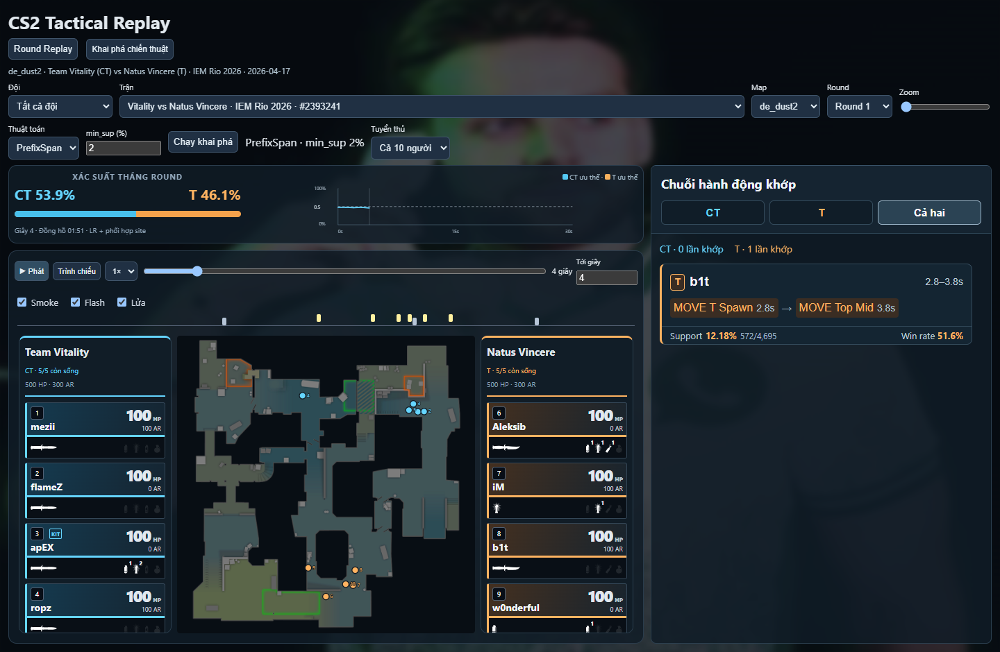

# CS2 Tactical Replay

Phát lại round đấu CS2 và dùng **PrefixSpan** để tìm các chuỗi di chuyển thường gặp. Demo có **226 bản ghi trận đấu, 4.806 round và 48.060 chuỗi tuyển thủ–round** trên Mirage, Inferno và Dust II.



## Chạy trên máy cá nhân

Cần **Python 3.11 trở lên**, Git và Git LFS. Bản demo đầy đủ chiếm khoảng **4,3 GiB**. Nếu repo ở chế độ Private, hãy đăng nhập bằng tài khoản đã được cấp quyền truy cập.

### Windows (PowerShell)

```powershell
git lfs install
git clone https://github.com/mtriet3ky/CS2-prefixspan-application.git
cd CS2-prefixspan-application
git lfs pull
python -m venv .venv
.\.venv\Scripts\python.exe -m pip install -e .
.\.venv\Scripts\python.exe -m cs2_tactical
```

### macOS / Linux

```sh
git lfs install
git clone https://github.com/mtriet3ky/CS2-prefixspan-application.git
cd CS2-prefixspan-application
git lfs pull
python3 -m venv .venv
.venv/bin/python -m pip install -e .
.venv/bin/python -m cs2_tactical
```

Mở [Round Replay](http://127.0.0.1:8767/) hoặc [Khai phá chiến thuật](http://127.0.0.1:8767/tactical.html). Nếu cổng 8767 đang bận, thêm `--port 8787` vào lệnh chạy. Nhấn `Ctrl+C` để dừng.
